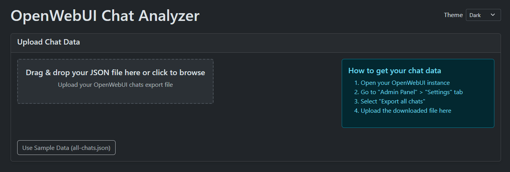
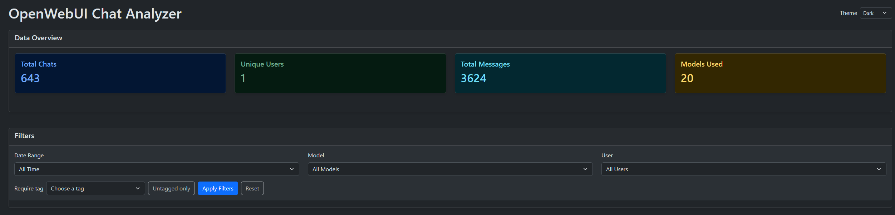
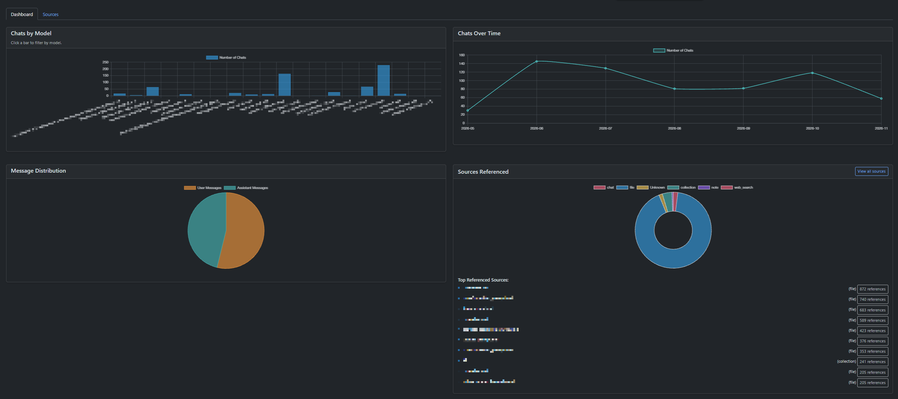
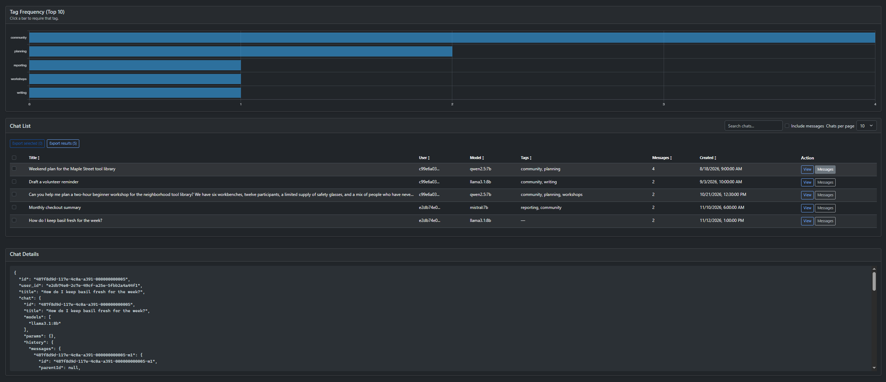
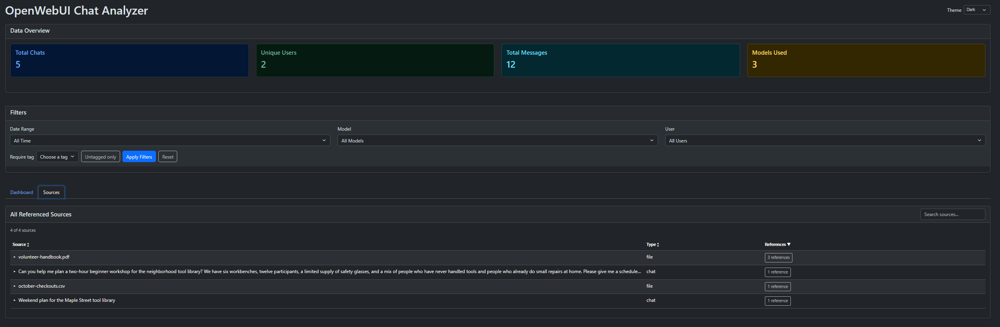

# OWChats

_OpenWebUI Chat Analyzer_

## Overview

This is a simple tool to analyze chats from OpenWebUI. It provides a user-friendly interface to visualize and understand chat data.

# ➣ [Click here to use the online version](https://dziban303.github.io/owchats/chat-analyzer.html)

## Getting Started

There are two ways to use this tool:

1. **Locally with your own chat data**: Download the [chat-analyzer.html](chat-analyzer.html) file, double click it to open it in your browser. Simply drag and drop your JSON file onto the upload area, or click it to open the file selector.
2. **Use the Github-hosted copy**: The page is [hosted on Github](https://dziban303.github.io/owchats/chat-analyzer.html) for ease of use. I'd recommend using a local copy though.
3. **Use the default sample file**. Click **Use Sample Data** to load [six synthetic chats](all-chats.json).

The sample loads when the analyzer is served over HTTP, including on GitHub Pages. To try it locally, run `python -m http.server 8000` from the repository root and open [the analyzer](http://localhost:8000/chat-analyzer.html).

- In **Cleanup**, review the duplicate pair **Draft a volunteer reminder** and **Draft a volunteer reminder (copy)**.
- In the **Chat List**, open **Messages** for **Weekend plan for the Maple Street tool library**, then select **Conversation tree** to compare the two replies to its final prompt.
- The weekend-planning chat also includes a model switch and synthetic usage measurements for trying **Generation Statistics**. These example measurements are illustrative.

## Downloading chats from OpenWebUI

To open exported chats on your own instance, expand **Open WebUI links** and save your instance’s base URL, such as `https://chat.example.com`. The analyzer remembers it in your browser and shows links in the Chat List, conversation viewer, and Sources views. Message links use the message ID to jump to the corresponding turn on Open WebUI versions that support it.

1. Open your OpenWebUI instance.
2. Go to "Admin Panel" > "Settings" tab. (If you're running OpenWebUI on the same computer, try http://localhost:3000/?settings=admin:db)
3. Select the option "Export all chats".

This will download a file named `all-chats-export-<id>.json` to your computer.

## Features

- Interactive charts showing model usage, chat timeline, and message distribution
- Sortable Model Analytics table with chats, saved replies, median reply length in characters, and the share of replies with sources. Select a model to open its chats.
- Token totals, median generation speed, timing coverage, and a reply-by-reply Generation Statistics table with recorded usage, saved chat parameters, and CSV export
- Model Switching with transitions along each branch, the number of preceding replies, and examples that open at the switch
- Compare Periods for message activity, model use, reply lengths, output tokens, and generation speed across two date ranges
- Activity heatmaps for user messages by weekday, hour, and calendar day, with weekly totals in your browser's time zone
  - Select a day or week total to open matching chats and update the message, source, and tag charts. Clear the activity filter in the Chat List to return to the broader results.
- Ability to filter chats by date, model, and user
- Detailed message view with source references when available
- Read-only conversation tree with the saved path and alternate branches. Open a conversation from the Chat List and select **Conversation tree**.
- Search every occurrence across conversation branches, compare alternate replies side by side, and export the saved path or the path through a selected message as Markdown
- Cleanup tab for empty chats, prompts without saved replies, and exact conversation duplicates within the same user's export data. Review the flagged chats and select records to export as JSON.
- Search functionality to find specific chats
- Sources and tags functionality
- File upload to analyze your own JSON data
- Theme selector with System, Light, Dark, and the four [Catppuccin](https://github.com/catppuccin/palette/blob/main/docs/css.md) flavors

## Export an analysis report

Choose **Export analysis report** in **Data Overview** to download a standalone HTML report. It includes the applied dashboard filters and drill-down, charts, model statistics, activity for the selected calendar year, and the top sources and tags. Open the file in any browser to view it offline or print it to PDF.

## Generation measurements

**Model Analytics** summarizes token counts and median generation speed. Its coverage column shows replies with token counts and replies with speed measurements out of the total saved replies. **Generation Statistics** lets you filter and sort individual replies, open them in the conversation viewer, inspect usage and saved chat parameters, and download all matching measurement rows as CSV.

The analyzer reads OpenAI-compatible token counts from saved `usage` and `info` objects. Ollama generation, prompt, load, and total durations are converted from nanoseconds. Saved llama.cpp `timings` use milliseconds. Generation speed uses output tokens and generation time, or an explicitly recorded token rate. Missing values display as **—**, and incomplete usage is excluded from speed summaries. The saved chat parameters describe the export's chat settings and may differ from the settings used for older replies. [Ollama usage documentation](https://docs.ollama.com/api/usage), [llama.cpp timing fields](https://github.com/ggml-org/llama.cpp/blob/master/tools/server/server-common.cpp)

In **Messages**, search includes alternate branches. Select a reply in **Conversation tree** to compare it with a sibling reply or export the path through that message. **Export saved path as Markdown** downloads the conversation's saved transcript.

## Screenshots
















## JSON File Structure

Each chat in the OpenWebUI export JSON file follows this structure:

```json
{
  "id": "unique-chat-id",
  "user_id": "user-identifier",
  "title": "Chat title",
  "chat": {
    "id": "",
    "title": "Chat title",
    "models": ["model-name"],
    "params": {},
    "history": {
      "messages": {
        "message-id": {
          "id": "message-id",
          "parentId": null or "parent-message-id",
          "childrenIds": ["child-message-ids"],
          "role": "user" or "assistant",
          "content": "Message text content",
          "timestamp": unix-timestamp,
          "models": ["model-name"]
        },
        // Additional messages...
      },
      "currentId": "current-message-id"
    },
    "messages": [
      {
        "id": "message-id",
        "parentId": null or "parent-message-id",
        "childrenIds": ["child-message-ids"],
        "role": "user" or "assistant",
        "content": "Message text content",
        "timestamp": unix-timestamp,
        "models": ["model-name"]
      },
      // Assistant response
      {
        "id": "message-id",
        "parentId": "parent-message-id",
        "childrenIds": [],
        "role": "assistant",
        "content": "Response text content",
        "model": "model-name",
        "modelName": "model-name",
        "modelIdx": 0,
        "userContext": null,
        "timestamp": unix-timestamp,
        "statusHistory": [],
        "sources": [
          // Reference sources if any
          {
            "source": {
              "id": "source-id",
              "user_id": "user-id",
              "name": "Source name",
              "description": "Source description",
              // Additional metadata...
            },
            "document": [
              // Text fragments from source documents
            ],
            "metadata": [
              // Metadata about source documents
            ]
          }
        ],
        "done": true
      }
    ],
    "tags": [],
    "timestamp": unix-timestamp,
    "files": []
  },
  "updated_at": unix-timestamp,
  "created_at": unix-timestamp,
  "share_id": null,
  "archived": false,
  "pinned": false,
  "meta": {
    "tags": ["tag-values"]
  },
  "folder_id": null
}
```

Key elements in each chat:

- Basic metadata: `id`, `user_id`, `title`, timestamps
- Messages: Array of user and assistant messages with their content
- Message relationships: Parent-child relationships between messages
- Sources: Referenced documents or knowledge sources (when available)
- Model information: Which AI models were used in the conversation
- Status information: Creation time, update time, tags, etc.
