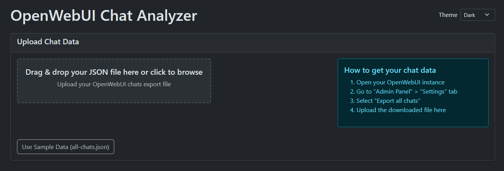
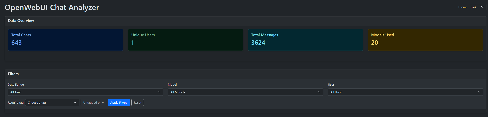
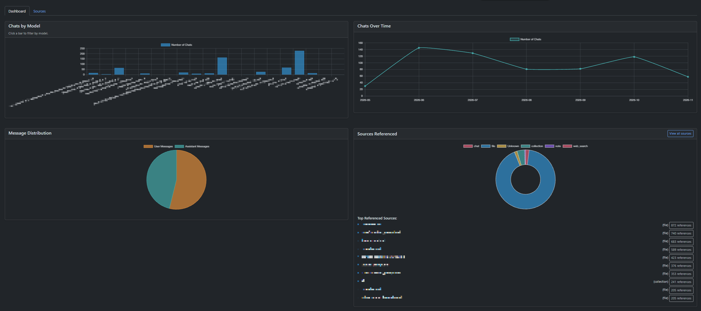
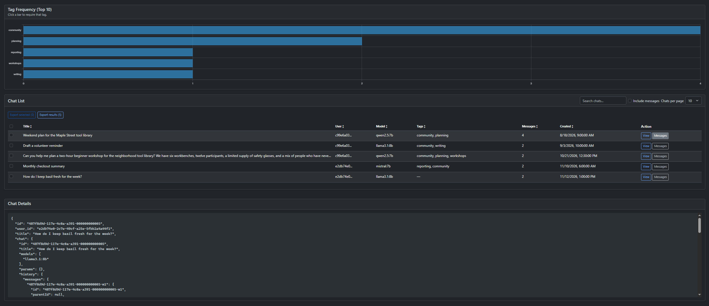
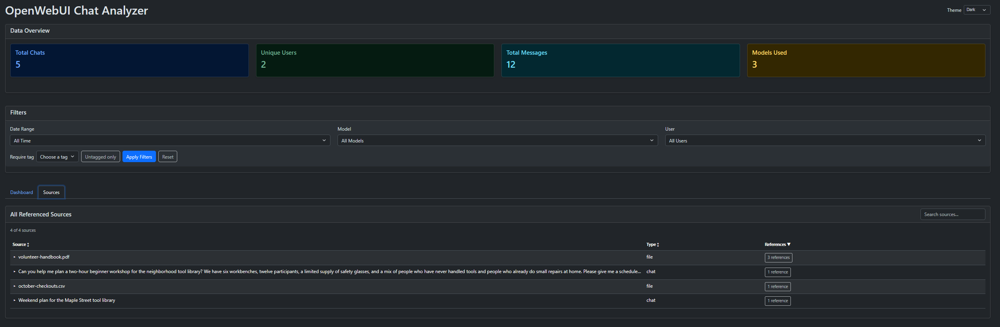

# OpenWebUI Chats Analyzer

## Overview

This is a simple tool to analyze chats from OpenWebUI. It provides a user-friendly interface to visualize and understand chat data.

## Getting Started

There are two ways to use this tool:

1. **Locally with your own chat data**: Download the [chat-analyzer.html](chat-analyzer.html) file, double click it to open it in your browser. Simply drag and drop your JSON file onto the upload area, or click it to open the file selector.
2. **Use the Github-hosted copy**: The page is [hosted on Github](https://dziban303.github.io/owchats/chat-analyzer.html) for ease of use. I'd recommend using a local copy though.
3. **Use the default sample file**. Click **Use Sample Data** to load [five synthetic chats](all-chats.json).

The sample loads when the analyzer is served over HTTP, including on GitHub Pages. To try it locally, run `python -m http.server 8000` from the repository root and open [the analyzer](http://localhost:8000/chat-analyzer.html).

## Downloading chats from OpenWebUI

To open exported chats on your own instance, expand **Open WebUI links** and save your instance’s base URL, such as `https://chat.example.com`. The analyzer remembers it in your browser and shows links in the Chat List, conversation viewer, and Sources views. Message links use the message ID to jump to the corresponding turn on Open WebUI versions that support it.

1. Open your OpenWebUI instance.
2. Go to "Admin Panel" > "Settings" tab. (If you're running OpenWebUI on the same computer, try http://localhost:3000/?settings=admin:db)
3. Select the option "Export all chats".

This will download a file named `all-chats-export-<id>.json` to your computer.

## Features

- Interactive charts showing model usage, chat timeline, and message distribution
- Ability to filter chats by date, model, and user
- Detailed message view with source references when available
- Search functionality to find specific chats
- Sources and tags functionality
- File upload to analyze your own JSON data

## Screenshots
















## JSON File Structure

Each chat in the OpenWebUI export JSON file follows this structure:

```json
{
  "id": "unique-chat-id",
  "user_id": "user-identifier",
  "title": "Chat title",
  "chat": {
    "id": "",
    "title": "Chat title",
    "models": ["model-name"],
    "params": {},
    "history": {
      "messages": {
        "message-id": {
          "id": "message-id",
          "parentId": null or "parent-message-id",
          "childrenIds": ["child-message-ids"],
          "role": "user" or "assistant",
          "content": "Message text content",
          "timestamp": unix-timestamp,
          "models": ["model-name"]
        },
        // Additional messages...
      },
      "currentId": "current-message-id"
    },
    "messages": [
      {
        "id": "message-id",
        "parentId": null or "parent-message-id",
        "childrenIds": ["child-message-ids"],
        "role": "user" or "assistant",
        "content": "Message text content",
        "timestamp": unix-timestamp,
        "models": ["model-name"]
      },
      // Assistant response
      {
        "id": "message-id",
        "parentId": "parent-message-id",
        "childrenIds": [],
        "role": "assistant",
        "content": "Response text content",
        "model": "model-name",
        "modelName": "model-name",
        "modelIdx": 0,
        "userContext": null,
        "timestamp": unix-timestamp,
        "statusHistory": [],
        "sources": [
          // Reference sources if any
          {
            "source": {
              "id": "source-id",
              "user_id": "user-id",
              "name": "Source name",
              "description": "Source description",
              // Additional metadata...
            },
            "document": [
              // Text fragments from source documents
            ],
            "metadata": [
              // Metadata about source documents
            ]
          }
        ],
        "done": true
      }
    ],
    "tags": [],
    "timestamp": unix-timestamp,
    "files": []
  },
  "updated_at": unix-timestamp,
  "created_at": unix-timestamp,
  "share_id": null,
  "archived": false,
  "pinned": false,
  "meta": {
    "tags": ["tag-values"]
  },
  "folder_id": null
}
```

Key elements in each chat:

- Basic metadata: `id`, `user_id`, `title`, timestamps
- Messages: Array of user and assistant messages with their content
- Message relationships: Parent-child relationships between messages
- Sources: Referenced documents or knowledge sources (when available)
- Model information: Which AI models were used in the conversation
- Status information: Creation time, update time, tags, etc.
